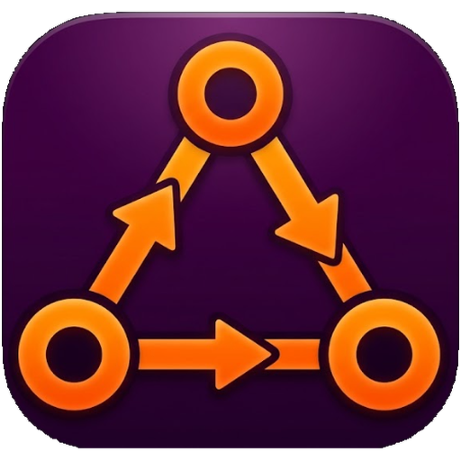
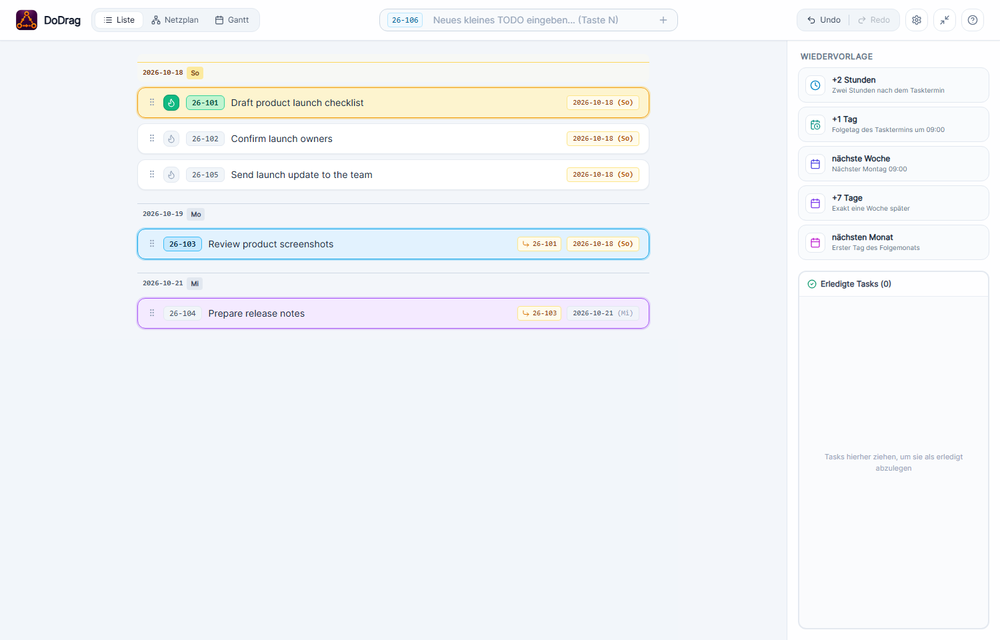
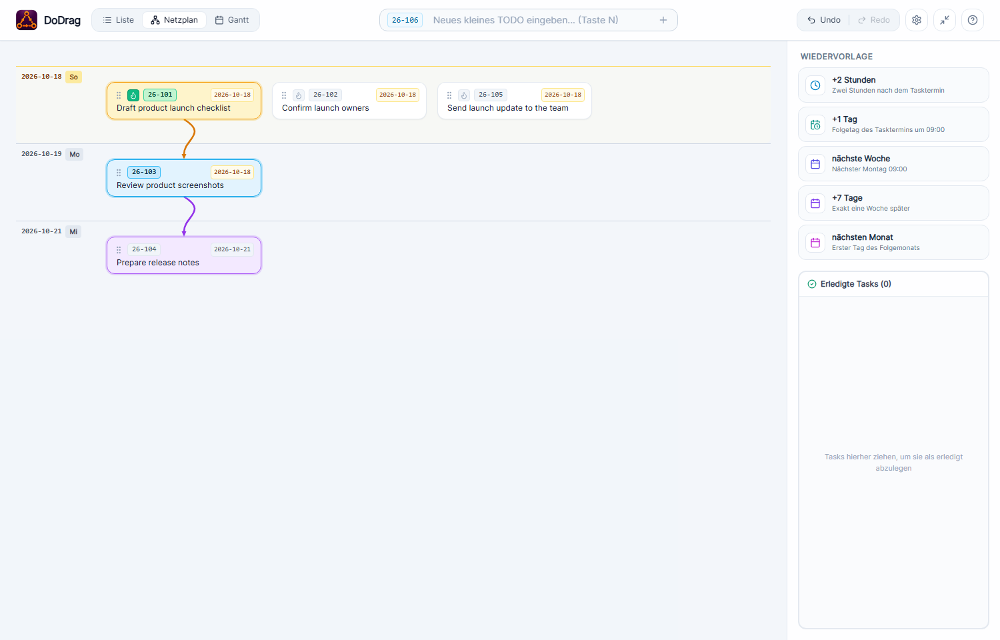
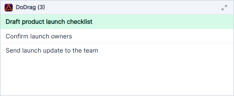

# DoDrag

<p align="center"></p>

**A small-task manager built around one question: what can I work on now?**

DoDrag keeps everyday TODO management lightweight. Its compact working view shows only tasks you can actually start; use the full list, network, and Gantt views when you need to plan ahead. In the focused view, work with open prerequisites stays out of the way until those prerequisites are done. When something cannot be done yet, drag it to a quick resubmission target and get back to the task at hand.

> **The idea:** managing small TODOs should take as little time as possible. Show the user only tasks they can work on right now, and let them defer a task with one drag.

## See it in action

### A focused task list

The date-layered list keeps actionable work easy to scan. Select a task to trace its upstream prerequisites and downstream effects.

<p align="center"></p>

### Reschedule without planning a new date

Drag a task onto a quick-resubmission target: **+2 hours**, **+1 day**, **next week**, **+7 days**, or **next month**. A task with open prerequisites still becomes actionable only when those prerequisites are complete.

<p align="center"></p>

### See dependencies as a network

Switch from the list to a dependency network or a Gantt timeline. Add a prerequisite by dragging the dependent task onto its prerequisite; drag with **Shift** to remove the relevant dependency edges.

<p align="center"></p>

### Keep the next tasks in a corner

The compact, corner-docked view stays out of the way and shows only work that can be started, prioritizing tasks you marked active.

<p align="center"></p>

## Features

- **Actionable work first:** the compact view filters out tasks blocked by unfinished prerequisites. It prefers tasks due today and falls back to other unblocked tasks when there is no work due today; the full views remain available for planning ahead.
- **One-drag rescheduling:** defer a task by dragging it to a relative date target instead of opening a date picker.
- **Dependencies at a glance:** list, network-plan, and Gantt views share task interactions and highlight upstream and downstream tasks.
- **Drag-and-drop planning:** move tasks between dates, connect prerequisites, or remove selected dependency edges with Shift-drag.
- **Small, traceable edits:** edit titles and dates in place, mark a task active, complete or reopen tasks, and undo or redo changes.
- **Native Windows desktop app:** the app stores task history in SQLite and can manage multiple database files. Browser fallback code is an internal development aid, not a supported product target.
- **Compact corner view:** dock a small always-on-top task window to a screen corner and restore the main window when needed.

## Languages and translations

Choose the interface language in **Settings**. On first launch, DoDrag uses the Windows user's display language, falling back to English if it is unsupported. The choice is saved and can be changed without restarting. Existing task titles and database names are user data and are not translated when switching languages.

| Language | Code | Verification |
| --- | --- | --- |
| German | `de` | Verified |
| English | `en` | Verified |
| French | `fr` | Not verified |
| Spanish | `es` | Not verified |
| Simplified Chinese | `zh-CN` | Not verified |
| Ukrainian | `uk` | Not verified |
| Brazilian Portuguese | `pt-BR` | Not verified |
| Japanese | `ja` | Not verified |
| Traditional Chinese | `zh-TW` | Not verified |
| Korean | `ko` | Not verified |
| Italian | `it` | Not verified |
| Polish | `pl` | Not verified |
| Turkish | `tr` | Not verified |
| Esperanto | `eo` | Not verified |
| Toki Pona | `tok` | Not verified |

The translations are **AI-generated**; only **English and German have been verified**. The other languages may contain linguistic or contextual mistakes. Automated tests check catalog completeness, interpolation parameters, and untranslated app-owned UI text; they do not establish linguistic correctness. Technical error details from Windows or third-party libraries may remain in their original language.

## Getting started

DoDrag is a Windows desktop application built with [Wails](https://wails.io/), Go, and React. To build it from source, install Go, Node.js/npm, and the Wails prerequisites for Windows, then run this repository's PowerShell build script:

#### Download a release

Download the executable for your Windows processor from the [DoDrag v0.1.3 release](https://github.com/sulimma/dodrag/releases/tag/v0.1.3):

- **Most Windows PCs (Intel/AMD, 64-bit):** [`dodrag-windows-amd64.exe`](https://github.com/sulimma/dodrag/releases/download/v0.1.3/dodrag-windows-amd64.exe)
- **Windows on ARM (ARM64):** [`dodrag-windows-arm64.exe`](https://github.com/sulimma/dodrag/releases/download/v0.1.3/dodrag-windows-arm64.exe)

Save the matching `.exe` and open it to run DoDrag; no installer is required.

#### Build from source

```powershell
./build.ps1
```

The script installs frontend dependencies in a local cache, runs the frontend and Go tests, builds the frontend, and packages `dodrag.exe`. It does not start the application. See [Architecture](ARCHITECTURE.md) for the code layout and runtime boundaries.

## Author and affiliation

Created by **Kolja Sulimma**, who is affiliated with [cronologic GmbH & Co. KG](https://www.cronologic.de/). cronologic manufactures [time-to-digital converters (TDCs)](https://www.cronologic.de/products/products-overview#tdcdata) and [analog-to-digital converters (ADCs)](https://www.cronologic.de/products/products-overview#adcdata) for applications including time-of-flight mass spectrometry (TOF-MS), quantum key distribution (QKD), and quantum computing.

## License

DoDrag is licensed under the [Apache License, Version 2.0](LICENSE).
