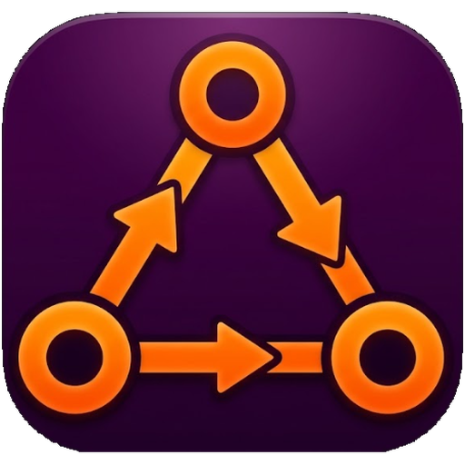
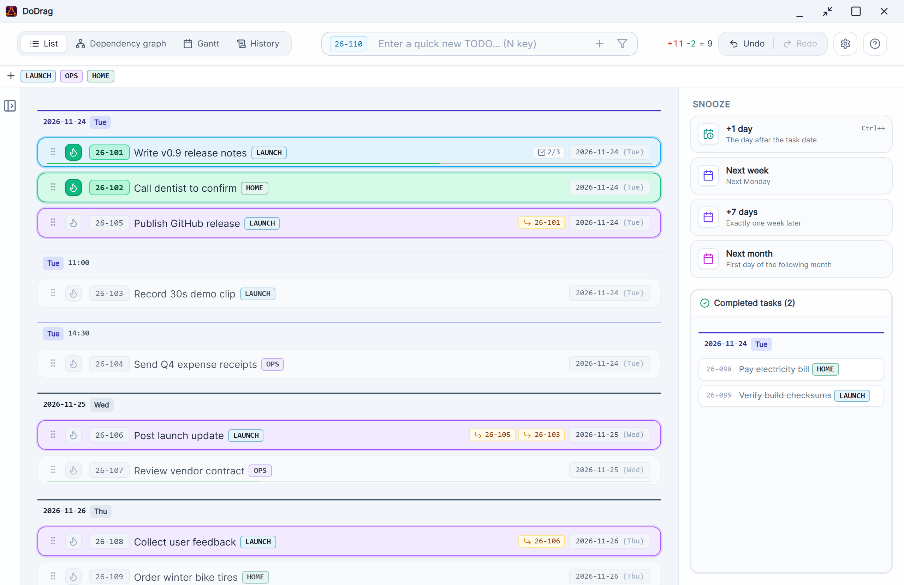
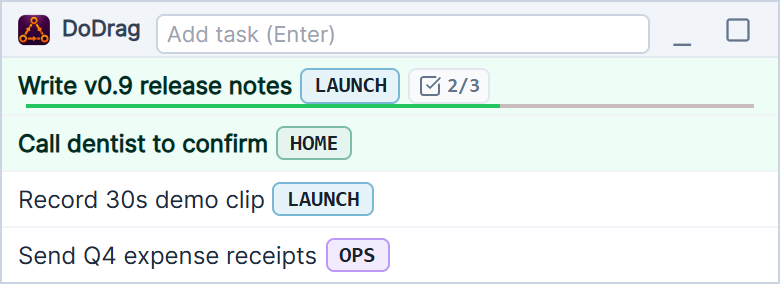
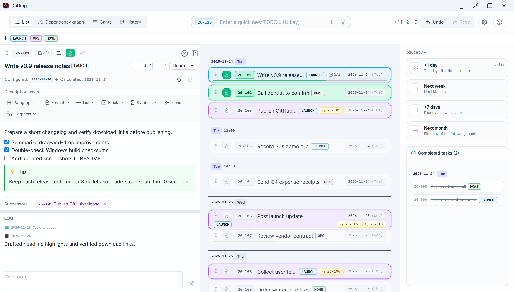
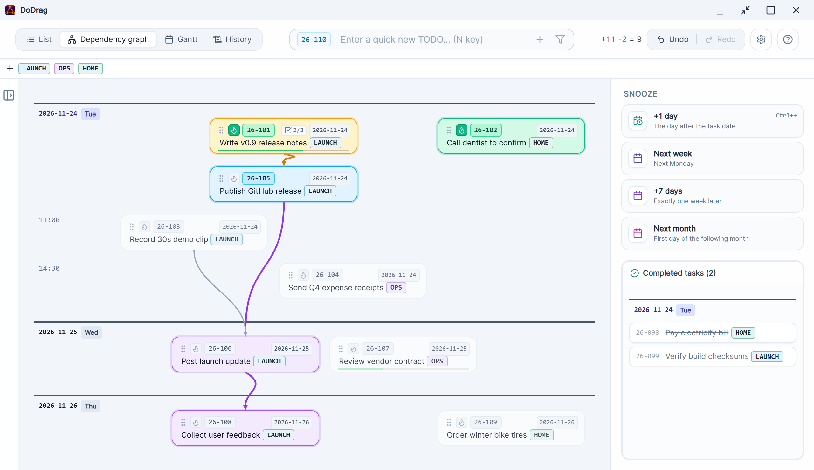
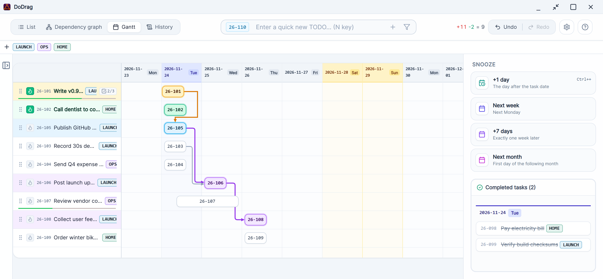

<p align="center">
  
</p>

<h1 align="center">DoDrag</h1>

<p align="center">
  <strong>A focus-first task manager for Windows and Linux — designed for ADHD brains and anyone tired of overwhelming TODO lists.</strong>
</p>

<p align="center">
  Stop staring at 50 tasks you can't even start yet.<br>
  DoDrag shows only what you can act on <em>right now</em>, and lets you snooze anything else in one drag.
</p>

<p align="center">
  <a href="https://github.com/sulimma/dodrag/releases/latest"><strong>Download for Windows or Linux</strong></a> ·
  <a href="#see-it-in-action">See it in action</a> ·
  <a href="#getting-started">Getting started</a>
</p>

<p align="center">
  
</p>

---

## Why DoDrag?

Most task apps turn into a guilt-inducing backlog full of blocked tasks, complex dates, and endless forms. DoDrag is built to eliminate that friction:

| The problem | How DoDrag solves it |
| --- | --- |
| **Overwhelm & choice paralysis** | Tasks waiting on unfinished prerequisites stay out of your compact working view until they are actually ready to start. |
| **Date-picker fatigue** | Can't do it today? Drag it onto **+1 day**, **Next week**, **+7 days**, or **Next month** — done in half a second. |
| **Out of sight, out of mind** | Dock the always-on-top **mini view** in any screen corner so your next 3–4 doable tasks stay gently visible while you work. |
| **Stray thoughts derailing focus** | Hit **`N`** (or type in the mini bar) to capture a thought in 2 seconds and immediately return to what you were doing. |
| **Forgetting what blocks what** | Drag any task onto its prerequisite to link them. Select a task to see its full upstream and downstream chain light up. |

---

## See it in action

### Stay on track with the always-on-top mini view

Press **`Ctrl+M`** to shrink DoDrag into a quiet corner widget. It shows **only unblocked tasks you can start right now**, puts your active tasks first, and hides everything else until it's actually ready.

<p align="center">
  
</p>

### Notes, checklists & diagrams right next to your list

Open any task's detail panel for Markdown notes, interactive checklists, callout boxes, KaTeX math, Mermaid & SMILES diagrams, progress tracking, and a chronological log — all auto-saved locally.

<p align="center">
  
</p>

### See the big picture when you need to plan

Switch between **List**, **Dependency graph**, **Gantt**, and **History** at any time. Drag a task onto its prerequisite to connect them, or **Alt-drag** to remove a link.

<p align="center">
  
</p>

<p align="center">
  
</p>

---

## Highlights

- **Built for momentum:** active-task highlighting, optional daily time markers (`11:00`, `14:30`), subtle progress bars, and a daily task balance (`+added -done = open`).
- **Projects & instant search:** organize with color-coded project badges and search/filter live across titles, IDs, Markdown, checklists, and logs.
- **Jump straight to your files:** open folders linked to tasks and projects in **Windows Explorer** or **VS Code** with one click.
- **Full undo & redo:** every drag, edit, and reschedule is stored in an event history so you can experiment fearlessly.
- **100% local & private:** portable Windows `.exe` and Ubuntu/Kubuntu 25.10 Linux `.deb`, plain SQLite database files (easy to back up or sync via Google Drive/OneDrive), no account, no cloud lock-in, and no automatic online update checks.
- **Rich Markdown editor:** checklists, tables, GitHub-style alerts, KaTeX formulas, 30 Mermaid diagram templates, SMILES chemistry formulas, Unicode shortcuts, and `.md` file drag-and-drop. Press **`?`** inside the app for built-in syntax & keyboard shortcut help.
- **15 interface languages:** auto-detected from Windows and switchable on the fly in Settings.

<details>
<summary>Supported languages (15)</summary>

Translations are AI-generated; **English** and **German** are human-verified (plus **Toki Pona**). Other languages may contain linguistic imperfections.

| Language | Code | Status |
| --- | --- | --- |
| German | `de` | Verified |
| English | `en` | Verified |
| Toki Pona | `tok` | Verified |
| French | `fr` | AI-translated |
| Spanish | `es` | AI-translated |
| Simplified Chinese | `zh-CN` | AI-translated |
| Traditional Chinese | `zh-TW` | AI-translated |
| Ukrainian | `uk` | AI-translated |
| Brazilian Portuguese | `pt-BR` | AI-translated |
| Japanese | `ja` | AI-translated |
| Korean | `ko` | AI-translated |
| Italian | `it` | AI-translated |
| Polish | `pl` | AI-translated |
| Turkish | `tr` | AI-translated |
| Esperanto | `eo` | AI-translated |

</details>

---

## Getting started

### Download for Windows

Grab the portable executable from the [latest DoDrag release](https://github.com/sulimma/dodrag/releases/latest) — no installer required:

- **Most Windows PCs (Intel / AMD, 64-bit):** [`dodrag-windows-amd64.exe`](https://github.com/sulimma/dodrag/releases/latest/download/dodrag-windows-amd64.exe)
- **Windows on ARM (ARM64):** [`dodrag-windows-arm64.exe`](https://github.com/sulimma/dodrag/releases/latest/download/dodrag-windows-arm64.exe)

Just open the `.exe` to run DoDrag. Whenever you like, **Settings** can copy it to `%LOCALAPPDATA%\Programs\DoDrag`, create Desktop/Start Menu shortcuts, and enable autostart.

### Download for Linux

Download `dodrag_<version>_amd64.deb` from the [latest DoDrag release](https://github.com/sulimma/dodrag/releases/latest) and install it with your package manager or `sudo apt install ./dodrag_<version>_amd64.deb`. The native package targets x86-64 Ubuntu/Kubuntu 25.10 (Questing) and uses the system GTK 3 and WebKitGTK 4.1 runtime libraries. Linux packaging is currently limited to this Ubuntu release and architecture.


### Copy a task summary

In **Settings → Plugins**, turn on **Copy task summary**. Select a task and expand its detail panel in the main window, then click **Copy task summary** and paste the text where you need it. The action appears only for a visible task in expanded main-window details, not in mini mode or project details. It copies the saved task ID and title, localized status, and ISO effective date as three lines; it does not copy the description, draft, or log.

The plugin is off by default. To remove the button, turn it off in the same settings section. Your choice stays in effect when you switch databases or restart DoDrag. Turning it off does not clear your clipboard.

### Build from source

DoDrag is a native desktop app built with [Wails](https://wails.io/), Go, and React. The Windows build uses Windows Wails prerequisites; Linux packaging targets Ubuntu/Kubuntu 25.10 (Questing) x86-64 and uses GTK 3 and WebKitGTK 4.1 development packages. For Windows, install Go, Node.js/npm, and the Wails prerequisites, then run:

```powershell
$version = Read-Host "Version (MAJOR.MINOR.PATCH)"
./build.ps1 -Version $version
```

Add `-Test` to run the full test and validation suite. See [ARCHITECTURE.md](ARCHITECTURE.md) and [docs/DEVELOPMENT.md](docs/DEVELOPMENT.md) for architecture and development details.

---

## Author & License

Created by **Kolja Sulimma**, affiliated with [cronologic GmbH & Co. KG](https://www.cronologic.de/) — manufacturer of [time-to-digital converters (TDCs)](https://www.cronologic.de/products/products-overview#tdcdata) and [analog-to-digital converters (ADCs)](https://www.cronologic.de/products/products-overview#adcdata) for time-of-flight mass spectrometry (TOF-MS), quantum key distribution (QKD), and quantum computing.

Licensed under the [Apache License, Version 2.0](LICENSE).
